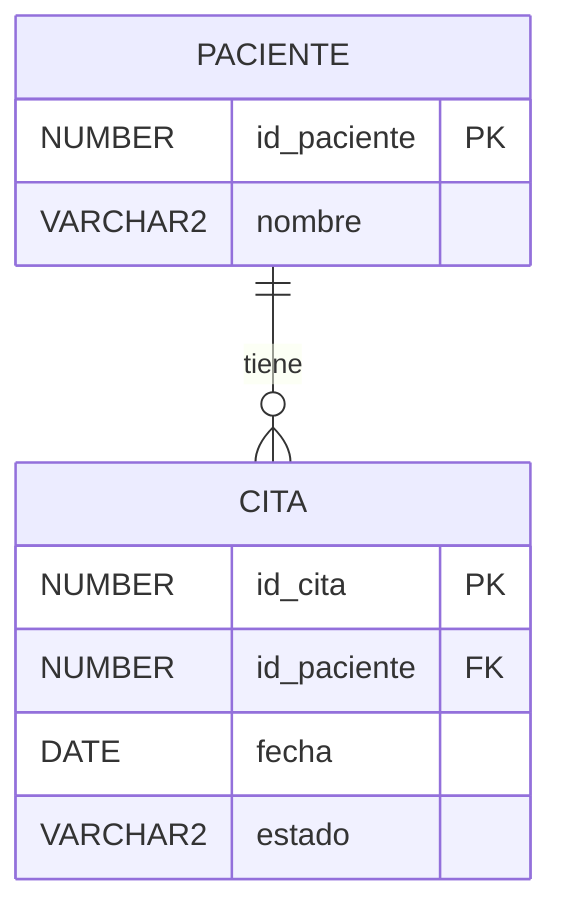

# Documento de diseño

## Resumen

Un script `citas.sql` en la raíz del repo, junto a los demás `.sql`, crea
la secuencia `seq_cita`, la tabla `cita`, el procedimiento
`registrar_cita` y la vista `v_citas_paciente`. Un segundo script,
`pruebas_citas.sql`, comprueba los criterios de aceptación.

## Arquitectura

Todo vive en el mismo esquema de la tabla `paciente`. La aplicación (o
quien ejecute SQL) registra citas solo a través de `registrar_cita`, para
que las validaciones estén en un único lugar, y las consulta a través de
`v_citas_paciente`.

## Componentes e interfaces

- **`registrar_cita(p_id_paciente, p_fecha)`**: valida la fecha y luego
  el paciente, e inserta la cita. No hace `COMMIT`; la transacción la
  cierra quien llama. Se eligió un procedimiento en lugar de un trigger
  porque deja los errores explícitos y fáciles de probar.
- **`v_citas_paciente`**: une `cita` con `paciente` y expone `id_cita`,
  `id_paciente`, `nombre_paciente`, `fecha` y `estado`, ordenado por
  `fecha`. Como un `ORDER BY` dentro de una vista no garantiza el orden
  al filtrarla, las consultas deben volver a ordenar por `fecha`.

## Modelos de datos

| Columna | Tipo | Reglas |
|---|---|---|
| `id_cita` | `NUMBER` | PK `pk_cita`, valor de `seq_cita` |
| `id_paciente` | `NUMBER` | `NOT NULL`, FK `fk_cita_paciente` a `paciente` |
| `fecha` | `DATE` | `NOT NULL` |
| `estado` | `VARCHAR2(20)` | `NOT NULL`, `DEFAULT 'PROGRAMADA'` |

Los nombres de restricciones siguen el estilo de
`consultas_basicas_oracle.sql` (`fk_emp_depto`).

## Manejo de errores

| Caso | Error | Mensaje |
|---|---|---|
| Fecha nula, pasada o igual a `SYSDATE` | ORA-20001 | La fecha de la cita debe ser futura |
| Paciente inexistente | ORA-20002 | El paciente no existe |

La fecha se valida primero porque no necesita consultar tablas.

## Estrategia de pruebas

`pruebas_citas.sql` usa bloques anónimos con `DBMS_OUTPUT` y termina con
`ROLLBACK` para no dejar datos. Cubre el caso normal (estado
'PROGRAMADA'), la fecha pasada (ORA-20001) y el paciente inexistente
(ORA-20002). Los pacientes de prueba se toman de la tabla `paciente`
existente en lugar de insertarlos.
