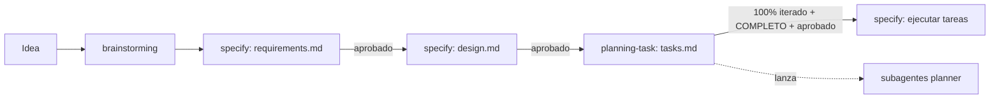

# LAB10

Laboratorio de SQL en Oracle. Los scripts `.sql` viven en la raíz
(`consultas_basicas_oracle.sql` es la referencia de estilo: banners
`-- ====`, restricciones con nombre como `fk_emp_depto`). Todo se escribe
en español.

## Flujo de trabajo para funcionalidades nuevas

Una funcionalidad nueva (tabla, consulta, procedimiento, vista, pantalla)
no se programa directo: pasa por una spec en `.kiro/specs/<nombre>/`.

| Paso | Quién | Qué sale | Cuándo se pasa al siguiente |
|---|---|---|---|
| 1. Entender la idea | skill `brainstorming` (desde `specify`) | Resumen confirmado por el usuario | El usuario confirma el resumen |
| 2. Requisitos | skill `specify`, fase 1 | `requirements.md` (historias y criterios EARS) | El usuario aprueba |
| 3. Diseño | skill `specify`, fase 2 | `design.md` | El usuario aprueba |
| 4. Tareas | skill `planning-task`, fase 3 de `specify` | `tasks.md` | 100% iterado, revisión final `COMPLETO` y el usuario aprueba |
| 5. Ejecutar | skill `specify`, fase 4 | Código y `[x]` en `tasks.md` | Una tarea por vez; el usuario pide la siguiente |

Piezas:

- `.claude/skills/specify/`: dirige todo el flujo y pide aprobación entre fases.
- `.claude/skills/planning-task/`: arma y revisa `tasks.md`. Lanza un
  `planner` para la estimación inicial si no hay tareas, o uno por tarea
  si ya existen, junta sus propuestas y repite hasta el 100%. Corre en la
  conversación principal, no dentro de un subagente.
- `.claude/agents/planner.md`: revisa una sola tarea por llamada
  (tamaño, si cumple la spec, si sobra o falta) contra el estado actual
  del repo. Modos `estimacion`, `propuesta` y `aplicar`.
- `.claude/skills/brainstorming/`: preguntas para entender la idea.
- `.claude/skills/skill-creator/`: para crear o mejorar skills.

## Reglas

- **No te saltes fases.** No escribas código sin `tasks.md` aprobado, ni
  `tasks.md` sin `design.md` aprobado. Si el usuario pide saltarse las
  aprobaciones, dilo en una línea.
- **`tasks.md` lo arma `planning-task`,** no un borrador a mano. Para saber
  si el plan está cerrado:
  `python .claude/skills/planning-task/scripts/progreso.py .kiro/specs/<nombre>/tasks.md`
  (debe dar 100%).
- **Si cambia un requisito o el diseño,** actualiza los documentos en
  orden (requisitos → diseño → tareas), quita del comentario
  `<!-- planner: revisadas ... -->` las tareas afectadas y vuelve a correr
  `planning-task`.
- **Una tarea a la vez** al implementar, y márcala `[x]` al terminar.
- `COMPLETO` significa que el plan es coherente, no que esté aprobado:
  la aprobación siempre es del usuario.
