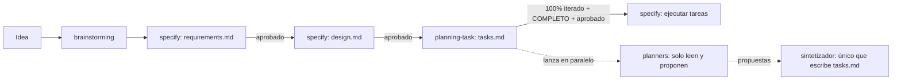

# LAB10

Laboratorio de SQL en Oracle. Los scripts `.sql` viven en la raíz
(`consultas_basicas_oracle.sql` es la referencia de estilo: banners
`-- ====`, restricciones con nombre como `fk_emp_depto`). Todo se escribe
en español.

## Flujo de trabajo para funcionalidades nuevas

Una funcionalidad nueva (tabla, consulta, procedimiento, vista, pantalla)
no se programa directo: pasa por una spec en `docs/specs/<nombre>/`.

| Paso | Quién | Qué sale | Cuándo se pasa al siguiente |
|---|---|---|---|
| 1. Entender la idea | skill `brainstorming` (desde `specify`) | Resumen confirmado por el usuario | El usuario confirma el resumen |
| 2. Requisitos | skill `specify`, fase 1 | `requirements.md` (historias y criterios EARS) | El usuario aprueba |
| 3. Diseño | skill `specify`, fase 2 | `design.md` | El usuario aprueba |
| 4. Tareas | skill `planning-task`, fase 3 de `specify` | `tasks.md` | 100% iterado, revisión final `COMPLETO` y el usuario aprueba |
| 5. Ejecutar | skill `specify`, fase 4 | Código y `[x]` en `tasks.md` | Una tarea por vez; el usuario pide la siguiente |

Piezas:

- `.claude/skills/specify/`: dirige todo el flujo y pide aprobación entre fases.
- `.claude/skills/planning-task/`: arma y revisa `tasks.md`. Lanza un
  `planner` para la estimación inicial si no hay tareas, o uno por tarea
  si ya existen, decide el consenso de sus propuestas, se lo pasa al
  `sintetizador` para que lo escriba, y repite hasta el 100%. Corre en la
  conversación principal, no dentro de un subagente.
- `.claude/workflows/plan-tasks.js`: la misma planeación como dynamic
  workflow (`/plan-tasks <spec>`), con fan-out de planners por ronda,
  consenso calculado en el script, un `sintetizador` que lo escribe y la
  evaluación del alcance de cada tarea en el informe. Sirve para specs grandes: los resultados intermedios no
  ocupan el contexto de la conversación. No hay aprobación a mitad de la
  corrida; si un planner se bloquea, el workflow termina y lo reporta.
- `.claude/agents/planner.md`: revisa tareas contra la spec y el estado
  actual del repo (tamaño, si cumple la spec, si sobra o falta) y devuelve
  propuestas. **Es de solo lectura** para que varios corran en paralelo.
  Modos `estimacion`, `propuesta` y `revision`.
- `.claude/agents/sintetizador.md`: **el único que escribe `tasks.md`**.
  Aplica en un solo paso el consenso de cada ronda (o la estimación, o las
  correcciones del cierre), renumera, actualiza el comentario de revisadas
  y mide el progreso.
- `.claude/skills/brainstorming/`: preguntas para entender la idea.
- `.claude/skills/skill-creator/`: para crear o mejorar skills.

## Reglas

- **No te saltes fases.** No escribas código sin `tasks.md` aprobado, ni
  `tasks.md` sin `design.md` aprobado. Si el usuario pide saltarse las
  aprobaciones, dilo en una línea.
- **`tasks.md` lo arma `planning-task`,** no un borrador a mano. Para saber
  si el plan está cerrado:
  `python .claude/skills/planning-task/scripts/progreso.py docs/specs/<nombre>/tasks.md`
  (debe dar 100%).
- **Si cambia un requisito o el diseño,** actualiza los documentos en
  orden (requisitos → diseño → tareas), quita del comentario
  `<!-- planner: revisadas ... -->` las tareas afectadas y vuelve a correr
  `planning-task`.
- **Una tarea a la vez** al implementar, y márcala `[x]` al terminar.
- `COMPLETO` significa que el plan es coherente, no que esté aprobado:
  la aprobación siempre es del usuario.
