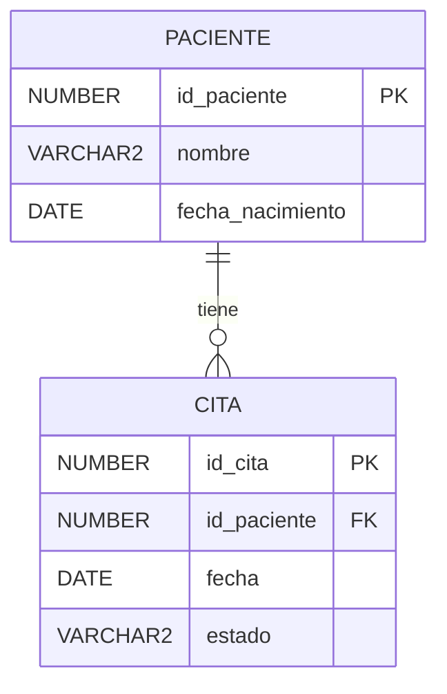

# Documento de diseño

## Resumen

Un script `citas.sql` en la raíz del repo, junto a los demás `.sql`, crea
la secuencia `seq_cita`, la tabla `cita`, el procedimiento
`registrar_cita` y la vista `v_citas_paciente`. Un segundo script,
`pruebas_citas.sql`, comprueba los criterios de aceptación.

## Arquitectura

Todo vive en el mismo esquema de la tabla `paciente`. La aplicación (o
quien ejecute SQL) registra citas solo a través de `registrar_cita`, para
que las validaciones estén en un único lugar, y las consulta a través de
`v_citas_paciente`, que solo muestra las citas de pacientes mayores de 18
años. El registro de citas no cambia: `registrar_cita` acepta pacientes de
cualquier edad, porque la regla de edad aplica solo a las consultas
(Requisito 2).

## Componentes e interfaces

- **`registrar_cita(p_id_paciente, p_fecha)`**: valida la fecha y luego
  el paciente, e inserta la cita. No hace `COMMIT`; la transacción la
  cierra quien llama. Se eligió un procedimiento en lugar de un trigger
  porque deja los errores explícitos y fáciles de probar.
- **`v_citas_paciente`**: une `cita` con `paciente` y expone `id_cita`,
  `id_paciente`, `nombre_paciente`, `fecha` y `estado`, ordenado por
  `fecha`. Como un `ORDER BY` dentro de una vista no garantiza el orden
  al filtrarla, las consultas deben volver a ordenar por `fecha`.
  Filtra a los pacientes mayores de edad con
  `WHERE p.fecha_nacimiento IS NOT NULL AND
  TRUNC(ADD_MONTHS(p.fecha_nacimiento, 18 * 12)) <= TRUNC(SYSDATE)`
  (criterios 2.2 y 2.3):
  - `ADD_MONTHS` evita los errores por años bisiestos que tendría restar
    `365 * 18` días. Quien nació el 29 de febrero cumple 18 el 28 de
    febrero de un año no bisiesto.
  - `TRUNC` en ambos lados hace que un paciente que cumple 18 hoy entre
    aunque `fecha_nacimiento` tenga hora.
  - `IS NOT NULL` deja explícito que un paciente sin fecha de nacimiento
    no aparece (la comparación con `NULL` ya lo excluiría, pero así se
    lee la intención).
  - Como `SYSDATE` se evalúa al consultar la vista, un paciente aparece
    el día que cumple 18 sin recrear nada.
  - El filtro va en la vista y no en cada consulta para que ninguna
    consulta lo olvide.

## Modelos de datos

| Columna | Tipo | Reglas |
|---|---|---|
| `id_cita` | `NUMBER` | PK `pk_cita`, valor de `seq_cita` |
| `id_paciente` | `NUMBER` | `NOT NULL`, FK `fk_cita_paciente` a `paciente` |
| `fecha` | `DATE` | `NOT NULL` |
| `estado` | `VARCHAR2(20)` | `NOT NULL`, `DEFAULT 'PROGRAMADA'` |

Columna usada de `paciente` (ya existe, no la crea este script):

| Columna | Tipo | Uso |
|---|---|---|
| `fecha_nacimiento` | `DATE` | Calcular la edad en `v_citas_paciente`. Nombre por confirmar con `DESC paciente` |

Los nombres de restricciones siguen el estilo de
`consultas_basicas_oracle.sql` (`fk_emp_depto`).

## Manejo de errores

| Caso | Error | Mensaje |
|---|---|---|
| Fecha nula, pasada o igual a `SYSDATE` | ORA-20001 | La fecha de la cita debe ser futura |
| Paciente inexistente | ORA-20002 | El paciente no existe |

La fecha se valida primero porque no necesita consultar tablas.

## Estrategia de pruebas

`pruebas_citas.sql` usa bloques anónimos con `DBMS_OUTPUT` y termina con
`ROLLBACK` para no dejar datos. Cubre el caso normal (estado
'PROGRAMADA'), la fecha pasada (ORA-20001) y el paciente inexistente
(ORA-20002). Para la consulta cubre:
- un paciente mayor de 18 años, cuyas citas aparecen en la vista;
- un paciente menor de 18, cuyas citas no aparecen;
- un paciente que cumple 18 hoy, cuyas citas sí aparecen;
- un paciente sin `fecha_nacimiento`, cuyas citas no aparecen.

Los pacientes de prueba se toman de la tabla `paciente` existente en
lugar de insertarlos. Si no hay uno de un caso (por ejemplo, alguien que
cumple 18 hoy), el bloque usa un `UPDATE` temporal de `fecha_nacimiento`
sobre un paciente existente, que el `ROLLBACK` final deshace.
